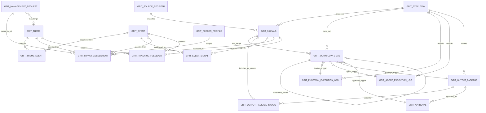

# GRIT-Scan Phase 1: Dataverse ERD and Phased Implementation Blueprint

**Status:** Implementation-planning specification  
**System of record:** Microsoft Dataverse  
**Architecture authority:** Current Wilson-based Phase 1 specifications

## 1. Decision summary

Build the signal, execution-log, package, approval, and state-ledger path first. That path gives the fastest governed Phase 1 demo. Strategic Horizon records are valuable but are not required to prove the Wilson governance model on Day 1.

**Day 1 answer:** `GRIT_Signals`, `GRIT_WorkflowState`, `GRIT_FunctionExecutionLog`, `GRIT_AgentExecutionLog`, `GRIT_OutputPackage`, `GRIT_OutputPackageSignal`, and `GRIT_Approval` must exist. A pre-existing or platform-provided execution/run entity is also required because several mandated tables have an `Execution` lookup.

The Day 1 demo can show these steps:

- source signal ingestion;
- deterministic execution logging;
- reasoning-agent proposals;
- controlled scoring;
- immutable package membership;
- human review through `ReviewGate()`;
- `TransitionGuard() = ALLOW`;
- append-only workflow persistence;
- separate publication/AIRIS-ready confirmations.

The Day 1 demo does not require themes, events, or reader apertures.

## 2. Dataverse ERD

The ERD shows `GRIT_EXECUTION` as an external prerequisite. The approved specifications require a direct execution/run lookup, but they have not yet approved its detailed table design. This blueprint does not count it as a new requested GRIT table. Use an existing execution/run entity where available. Otherwise, define it before you implement the mandatory lookup columns.

`GRIT_FunctionCatalog` is also an existing controlled-configuration prerequisite. Seed the Day 1 function versions there. Keep it outside this requested ERD scope.

`GRIT_WorkflowState.Grit_TriggerRecordId` is a multi-table lookup to the relevant function log, agent log, output package, or approval. It is conditional by trigger type. `GRIT_Signals.CurrentWorkflowState` is a rebuildable projection lookup to the latest accepted workflow-state row. It is not part of the immutable event ledger.

## 3. Table portfolio and phasing

Volume estimates assume an initial Wilson pilot with these rates:

- 1,000-5,000 source signals per month;
- 1-3 signal transitions per active signal per week;
- 1-2 package cycles per reporting period.

Re-baseline after 90 days of production telemetry.

| Table | Classification | Purpose | Owner | Estimated volume | Dependencies | Priority |
| --- | --- | --- | --- | ---: | --- | --- |
| `GRIT_Signals` | PHASE 1 MANDATORY | Shared factual source record and current-state projection. | Supervisor-controlled persistence; R&A data steward. | 1,000-5,000/month | Approved source policy, fingerprinting, governed LOB/entity context. | P0 / Day 1 |
| `GRIT_WorkflowState` | PHASE 1 MANDATORY | Append-only signal transition ledger, replay source, and state audit trail. | Supervisor only. | 5,000-25,000/month | Signals, execution/run, TransitionGuard, supporting trigger records. | P0 / Day 1 |
| `GRIT_OutputPackage` | PHASE 1 MANDATORY | Immutable review/published-output package version and content hash. | Supervisor-controlled persistence; R&A approver owns decision. | 10-100/month | Execution/run, minimal controlled package renderer, ReviewGate. Full PackAssembly is optional after Day 1. | P0 / Day 1 |
| `GRIT_OutputPackageSignal` | PHASE 1 MANDATORY | Immutable ordered membership snapshot for exact package signal versions. | Supervisor-controlled persistence. | 1,000-10,000/month | OutputPackage, Signals, content hashes. | P0 / Day 1 |
| `GRIT_Approval` | PHASE 1 MANDATORY | Named human approval/rejection/hold decision for one exact package version. | Named human reviewer; Supervisor persists validated decision. | 10-200/month | OutputPackage, ReviewGate, reviewer/role identity. | P0 / Day 1 |
| `GRIT_FunctionExecutionLog` | PHASE 1 MANDATORY | Audit ledger for deterministic functions, including guard/review results and retries. | Supervisor-controlled persistence. | 10,000-100,000/month | Execution/run, Function Catalog, RetryBudget. | P0 / Day 1 |
| `GRIT_AgentExecutionLog` | PHASE 1 MANDATORY | Audit ledger for agent proposals, validation, provenance, and critic outcomes. | Supervisor-controlled persistence. | 2,000-20,000/month | Execution/run, connected agent definitions, response contracts. | P0 / Day 1 |
| `GRIT_ReaderProfile` | PHASE 1 OPTIONAL | Governed audience, aperture, materiality, routing, and report template configuration. | R&A configuration steward. | 10-100 active rows | LOB profile/master data, ApertureRouting. | P1 / after Day 1 |
| `GRIT_Event` | PHASE 2 | Versioned shared register for distinct real-world developments. | Supervisor-controlled persistence; R&A steward. | 100-1,000/month | Signals, EventMatch, RegisterWriteGate. | P2 |
| `GRIT_EventSignal` | PHASE 2 | Immutable evidence relationship from event to signal version. | Supervisor-controlled persistence. | 1,000-10,000/month | Events, Signals, EventMatch, RegisterWriteGate. | P2 |
| `GRIT_ImpactAssessment` | PHASE 2 | Reader-specific BA/LOB/BU assessment without changing shared facts. | Supervisor-controlled persistence; R&A/LOB assessment owner. | 500-10,000/month | ReaderProfile, Signals/Events, ScoreRisk, governed business context. | P2 |
| `GRIT_Theme` | PHASE 3 | Versioned Group-level strategic horizon register. | Supervisor-controlled persistence; R&A strategic steward. | 20-200 active; version history retained | Events, ThemeMetricCalculation, RegisterWriteGate, lifecycle policy. | P3 |
| `GRIT_ThemeEvent` | PHASE 3 | Versioned relationship between strategic theme and supporting event. | Supervisor-controlled persistence. | 100-2,000/month | Themes, Events, ThemeMatch, RegisterWriteGate. | P3 |
| `GRIT_ManagementRequest` | PHASE 1 OPTIONAL | Governed leadership monitoring request; sole basis for `P1` priority. | R&A governance owner; named requester. | 5-50/quarter | ApertureRouting, optional Theme lookup. | P1 / MVP demo |
| `GRIT_TrackingFeedback` | PHASE 1 OPTIONAL | Post-publication LOB feedback as governance input. | LOB Head submits; Supervisor persists. | 20-500/month | Signals/Events/Themes, RegisterWriteGate. | P1 / MVP optional |
| `GRIT_SourceRegister` | PHASE 2 | Governed source class, credibility, owner, and review controls read by `CredibilityLookup()`. | R&A source steward. | 50-500 active rows | CredibilityLookup, source onboarding policy. | P2 |

**Feedback relationships are read-only inputs.** `GRIT_TrackingFeedback` links to a signal, event, or theme for traceability. It never writes to them. Any resulting change passes through `RegisterWriteGate()` and policy-required approval.

### 3.1 Classification rationale

- **PHASE 1 MANDATORY** proves the non-negotiable governance path: auditable signals, deterministic execution evidence, immutable packages, named human review, and guarded state persistence.
- **PHASE 1 OPTIONAL** enables the first personalized views. It is not required to prove the Day 1 Wilson demo. Until `GRIT_ReaderProfile` is implemented, a fixed pilot profile can be configuration-managed outside Dataverse. Do not create competing facts.
- **PHASE 2** adds governed event intelligence and LOB materiality using the same signals and evidence.
- **PHASE 3** adds Group strategic horizon themes once the event register has enough quality, diversity, and lifecycle evidence to avoid prompt-only clustering.

## 4. Minimum viable Phase 1 implementation

### 4.1 Day 1 required tables

1. `GRIT_Signals`
2. `GRIT_WorkflowState`
3. `GRIT_FunctionExecutionLog`
4. `GRIT_AgentExecutionLog`
5. `GRIT_OutputPackage`
6. `GRIT_OutputPackageSignal`
7. `GRIT_Approval`

**Required supporting dependency:** a Dataverse execution/run record referenced by `GRIT_Execution` lookups. For the demo, this record can come from an existing platform execution table, provided it exposes a stable GUID and execution/version/correlation fields.

### 4.2 Day 1 minimal fields and controls

| Table | Minimum Day 1 controls |
| --- | --- |
| `GRIT_Signals` | Signal ID, headline, source name/URL/date, country/market, fingerprint, content hash/version, evidence confidence, current workflow-state lookup, execution lookup, correlation ID. |
| `GRIT_WorkflowState` | Implement the approved lean ledger schema from Step 2, alternate keys, append-only permissions, and `TransitionGuard() = ALLOW` evidence. |
| `GRIT_FunctionExecutionLog` | Function/version, execution/signal/package references where applicable, canonical input/output hashes, status, idempotency key, attempt/retry metadata, and `TransitionGuard`/`ReviewGate` results. |
| `GRIT_AgentExecutionLog` | Agent/version, execution/signal reference, task, proposal payload reference/hash, citations/evidence reference, status, and Supervisor validation result. |
| `GRIT_OutputPackage` | Package ID/version, package and membership hashes, status, immutable content file/reference, supersedes lookup, execution lookup. |
| `GRIT_OutputPackageSignal` | Exact required membership fields: package lookup, signal lookup, signal version, signal content hash, membership sequence, included UTC time, inclusion reason. |
| `GRIT_Approval` | Exact package lookup, package/membership hashes, named reviewer identity/role, decision, UTC timestamp, decision comments, separation-of-duties result. |

Enable Dataverse auditing and change tracking on every Day 1 table. Restrict direct create/update/delete permissions:

- The Supervisor service identity is the only workflow-state writer.
- Named humans can submit a review decision. They do not directly write signal state.
- Agents have no Dataverse write privilege.

### 4.3 Day 1 demo boundary

The demo proves reproducible governance. It does not aim for volume or visual sophistication. Use a small governed signal set and demonstrate the full path. The demo can defer live broad-source crawling, automatic event/theme creation, reader-aperture personalization, and executive pack design.

## 5. Build sequence

### Step 1: Core governance

- Create/confirm the execution/run dependency and security roles.
- Create `GRIT_Signals`, `GRIT_WorkflowState`, `GRIT_FunctionExecutionLog`, and `GRIT_AgentExecutionLog`.
- Configure global choices, alternate keys, auditing, change tracking, optimistic-concurrency handling, and `GRIT_Signals.CurrentWorkflowState` projection.
- Seed governed `GRIT_FunctionCatalog` entries for `TransitionGuard`, `ReviewGate`, `ScoreRisk`, `FingerprintArticle`, `CredibilityLookup`, `RetryBudget`, and `PublicationConcurrencyLock`.

### Step 2: Signal processing

- Implement Supervisor orchestration against the Day 1 tables.
- Log agent proposals and deterministic execution results.
- Enforce `TransitionGuard()` before every state persistence.
- Demonstrate `NEW -> FETCHED -> DEDUPED -> ASSESSED -> CRITIQUED` with Critic evidence. `ScoreRisk()` alone cannot produce `CRITIQUED`.

### Step 3: Review

- Create `GRIT_OutputPackage`, `GRIT_OutputPackageSignal`, and `GRIT_Approval`.
- Implement immutable package/version/membership hashes.
- Invoke `ReviewGate()` for package-level review.
- Demonstrate approval, hold, reject, and package-wide `RETURN_FOR_REWORK`. Only `RETURN_FOR_REWORK` causes `PENDING_REVIEW -> ASSESSED`, after `TransitionGuard()` allows it.
- Demonstrate independent `PUBLICATION_CONFIRMED` and `AIRIS_HANDOFF_READY` branches, with a named human commitment before published status is asserted.

### Step 4: Strategic Horizon

- Create `GRIT_ReaderProfile` first if material-versus-wide reader routing is required.
- Add `GRIT_Event`, `GRIT_EventSignal`, and `GRIT_ImpactAssessment` with `EventMatch`, `ApertureRouting`, and `RegisterWriteGate`.
- Add `GRIT_Theme` and `GRIT_ThemeEvent` only when the event register has governed evidence coverage and lifecycle policy. Use `ThemeMetricCalculation()` and `ThemeEscalationAssessment()` for controlled lifecycle proposals.
- Ensure theme/event proposals and writes never become signal workflow states.

### Step 5: Reporting

- Implement `PackAssembly()` for policy-permitted sections and citations.
- Prefer a single immutable package with independently identifiable strategic and operational sections when they use the same approved evidence population.
- Build drill-down `Theme -> Event -> Signal -> LOB Impact Assessment` and roll-up in the opposite direction.
- Ensure all draft/proposed content carries a visible status. Ensure reporting treats only policy-permitted approval/publication facts as published.

## 6. Components safe to defer

The following can be deferred without breaking the Phase 1 governance path:

| Deferred component | Earliest phase | Why governance remains intact |
| --- | --- | --- |
| `GRIT_ReaderProfile` and `ApertureRouting()` | Phase 1 optional | A fixed pilot audience can be used. Shared signals, packages, approvals, and transitions remain governed. |
| Event register and `EventMatch()` | Phase 2 | Signals remain auditable and can be reviewed/published without event clustering. |
| LOB impact assessments and `ScoreRisk()` at impact-assessment level | Phase 2 | The existing signal/risk assessment and review package still operate. |
| Theme register, `ThemeMatch()`, `ThemeMetricCalculation()`, and `ThemeEscalationAssessment()` | Phase 3 | Strategic horizon narrative and lifecycle evaluation wait for Phase 3. Core operational governance remains valid. |
| Advanced reporting layouts and `PackAssembly()` sections | Phase 3 | Immutable package content can be represented in a simple controlled format. |
| `PublicationConcurrencyLock()` | Day 1 optional for a single-user demo | Technical duplicate-delivery protection can be added before concurrent publication is enabled. It must never be treated as approval. |
| AIRIS delivery integration | Day 1 optional | `AIRIS_HANDOFF_READY` can be demonstrated with a validated mock payload. Actual delivery can be deferred. |

Do **not** defer `TransitionGuard`, `ReviewGate`, `GRIT_OutputPackageSignal`, append-only `GRIT_WorkflowState`, execution logs, or named human approval. Deferring any of these breaks the Phase 1 governance claim.

## 7. Architecture guardrails

- Dataverse is the system of record.
- The Supervisor is the only workflow-state writer.
- Agents reason and propose. Deterministic functions execute controlled operations.
- `ReviewGate()` is the sole business approval gate.
- `TransitionGuard()` validates each actual signal transition.
- `RegisterWriteGate()` validates typed theme/event/relationship/impact mutations. It is not a signal transition mechanism.
- `PublicationConcurrencyLock()` is technical mutual exclusion only.
- Reader appetite changes routing and presentation, never shared theme/event/signal facts.
- Wide and material readers use the same underlying signal and event evidence.

## 8. Phase exit criteria

| Phase | Exit criterion |
| --- | --- |
| Day 1 / Phase 1 core | A reviewer can approve a hash-matched immutable package; each resulting signal transition has `TransitionGuard() = ALLOW`; the audit trail can be replayed from Dataverse. |
| Phase 1 optional | At least two governed reader profiles demonstrate different views over the same shared signal evidence without mutating it. |
| Phase 2 | Events and reader-specific impact assessments are versioned, traceable to signals, and accepted only through RegisterWriteGate. |
| Phase 3 | Themes and event relationships are lifecycle-governed, metrics-backed, reviewed as required, and produce citation-preserving strategic reporting. |
